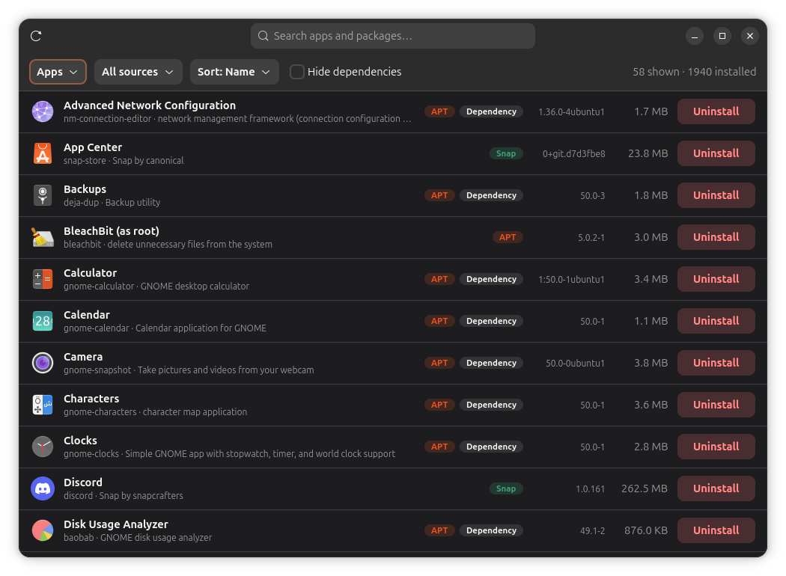

<div align="center">


# Uninstaller

**Remove apps from Linux completely: the program, its settings, and the leftovers in your home folder.**

[](https://github.com/cyb3rl00m/uninstaller/releases/latest)
[](LICENSE)


[**Download**](https://github.com/cyb3rl00m/uninstaller/releases/latest) ·
[Features](#features) ·
[Install](#install) ·
[Safety](#safety-first) ·
[Report a bug](https://github.com/cyb3rl00m/uninstaller/issues/new)

<br>



</div>

<br>

## Why

When you uninstall something on Linux, a lot stays behind: config files in `/etc`, dependencies
nothing uses anymore, and folders like `~/.config/<app>` and `~/.cache/<app>`. Reinstall the app
and it comes back with the same broken settings.

**Uninstaller** shows everything installed on your PC (APT or DNF, Snap and Flatpak) in one
searchable list, and removes the app *and* everything it left behind.

## Features

| Feature | What it does |
|---|---|
| 📦 **One list for everything** | APT packages (Ubuntu) or RPM packages (Fedora), Snaps and Flatpaks together, with icons, versions and sizes |
| 🔍 **Instant search** | Just start typing anywhere (or press <kbd>Ctrl</kbd>+<kbd>F</kbd>). Searches names and descriptions |
| 🧹 **Complete removal** | Removes the package, its system config files and dependencies nothing else needs |
| 🏠 **Home folder cleanup** | Finds the app's folders in `~/.config`, `~/.local/share`, `~/.local/state`, `~/.cache`, `~/.<app>` and `~/snap/<app>`, and moves the ones you choose to the Trash |
| 🗂️ **Leftover configs** | Ubuntu: lists packages that were removed earlier but left config files behind, with a **Purge** button |
| ⚙️ **Filters** | Apps only or all packages, by source, hide dependencies, sort by name or size |

### What "Uninstall" runs

| Source | Command | Also removes |
|---|---|---|
| **APT** (Ubuntu) | `apt-get purge --autoremove` | config files in `/etc`, unused dependencies |
| **DNF** (Fedora) | `dnf remove` | unused dependencies, leftover `.rpmsave` config files |
| **Snap** | `snap remove --purge` | snap data, no backup snapshot left behind |
| **Flatpak** | `flatpak uninstall --delete-data` | app data in `~/.var/app`, runtimes nothing uses anymore |

## Safety first

- 👀 **Preview before removing:** for APT and DNF packages it does a dry run and shows *every* package that
  will be removed, so you never take half the desktop with you by accident.
- 🛡️ **Core packages are protected:** essential packages, `ubuntu-desktop`, `gdm3`, `snapd`, snap bases,
  Fedora's protected packages (`dnf`, `systemd`, `sudo`, the kernel…) and similar get a red warning
  and need an extra "I understand" tick. dnf itself also refuses to remove its protected packages.
- 🗑️ **Personal folders go to the Trash**, not straight into oblivion. Wrong folder? Restore it.
- 🔑 **Your password is asked for each action** through the normal system prompt. Nothing runs as root
  in the background.

## Install

1. Download the latest zip from the [**Releases page**](https://github.com/cyb3rl00m/uninstaller/releases/latest) and unzip it
   (or `git clone https://github.com/cyb3rl00m/uninstaller`).
2. Open a terminal in the unzipped folder and run:

```bash
bash install.sh
```

The same command works on **Ubuntu and Fedora**: it detects your system and installs anything missing
with `apt` or `dnf`. Then open **Uninstaller** from the app grid.

- **Update:** download the new zip and run `bash install.sh` again. It replaces the old version.
- **Remove:** `bash install.sh --uninstall`

<details>
<summary><b>Fedora notes</b></summary>
<br>

- **You may be asked for your password twice:** dnf needs admin rights even for the dry run, so it
  asks once for the preview and once for the actual removal.
- **"Dependency" labels** come from `dnf repoquery --userinstalled`. If dnf can't tell, every package is
  treated as installed by you and nothing is hidden by "Hide dependencies".
- **Fedora Atomic** (Silverblue, Kinoite, Bazzite…): the base system is read-only and managed with
  `rpm-ostree`, so only Flatpaks (and Snaps) are listed. Remove layered packages with
  `rpm-ostree uninstall`.

</details>

<details>
<summary><b>Known limits</b></summary>
<br>

- Home folders are matched by name (package name, app name, launcher ID). Apps that store data
  under an unrelated name won't be found. You'll see exactly what was found before anything is deleted.
- Settings stored in dconf/GSettings are not removed.
- AppImages and programs installed by hand (e.g. in `/opt`) aren't listed.

</details>

## Contributing

Bug reports and ideas are very welcome:

- **Missed leftovers:** an app left a folder the cleanup didn't find? [Open an issue](https://github.com/cyb3rl00m/uninstaller/issues/new) with the app and folder name.
- **Wrong matches:** a folder offered for deletion that doesn't belong to the app? Please report it.
- **Testing on other systems:** Fedora KDE, Nobara, Kubuntu, Debian, Mint, Pop!_OS…

See the [changelog](CHANGELOG.md) for what changed in each version.

## About this project

Uninstaller was built by me [cyb3rl00m](https://github.com/cyb3rl00m) with the help of
Claude, an AI assistant by Anthropic. It's a sibling of [Crash Inspector](https://github.com/cyb3rl00m/crash-inspector).

## License

[MIT](LICENSE): free to use, change and share.
